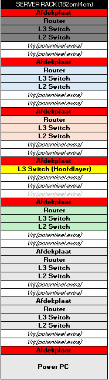

# Rack Architecture, Layout & Simulation

Het opbouwen van een netwerk-rack vereist een goede verdeling van gewicht, warmte-afvoer, kabelbeheer en schaalbaarheid.

## Ontwerpregels & Praktijkuitvoering:

1. **Virtueel & Logisch Ontwerp:** 
   Elk rack wordt eerst geschetst in Excel en nagebouwd in **Cisco Packet Tracer**:
   - **Physical View:** Fysieke weergave van de rackopbouw voor praktijkopdrachten en studentenpod-ontwerpen.
   - **Logical View:** 2D-logische weergave waarin racks worden ingedeeld op basis van herkenbare stedennamen (in plaats van nummers) voor beter overzicht.

2. **Fysieke Opbouw & Uitbreidbaarheid:**
   - Racks zijn fysiek gemonteerd met klemmen voor routers en net gemonteerde stopcontacten/PDU's.
   - Standaardindeling is berekend op **4 studenten per rack** (inclusief hoofdlayer), met voldoende vrije ruimte voor eventuele uitbreiding naar **6 studenten per rack**.

3. **Kabelbeheer & Luchtstroom:**
   - Gebruik van klittenband (velcro) in plaats van harde kabelbinders om schade aan kabels te voorkomen.
   - Vrije ruimtes en afdekplaten toegepast voor optimale ventilatie en koeling van zware apparatuur.

---

## Foto's van het Praktijkresultaat

Hieronder zijn de fysieke foto's toegevoegd van de daadwerkelijk opgebouwde racks en de voorbereide switches:

- **Volledig opgebouwd serverrack:**  
  

- **Gestapelde switches klaar voor configuratie en uitrol (inclusief status-labels):**  
  

- **Schematische Rack Layout:**  
  
